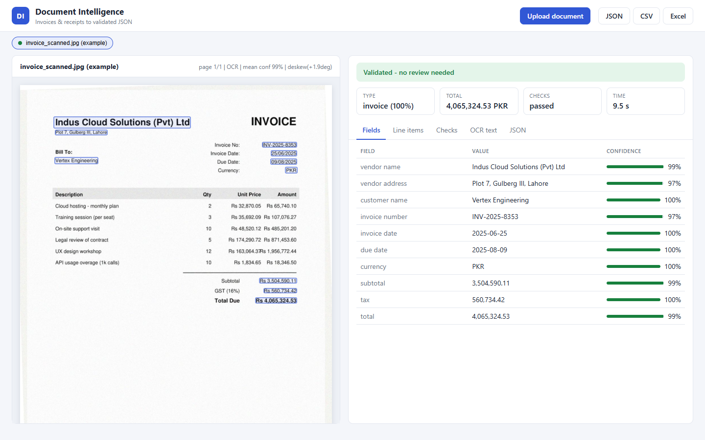
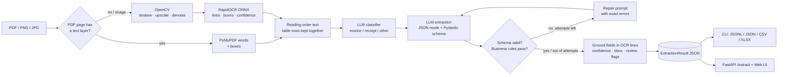

# Document Intelligence Pipeline

[](https://www.python.org/)
[](LICENSE)
[](https://github.com/MuhammadAhmadRajpoot/document-intelligence-pipeline/actions/workflows/ci.yml)

Turn invoices, receipts and other business documents (PDFs or photos/scans) into **validated, structured JSON**. The pipeline reads the PDF text layer when there is one and falls back to CPU-only OCR when there is not. An LLM fills strict Pydantic schemas, and the output is then checked against the document's own arithmetic. Every field gets a confidence score based on where it was found on the page. When the numbers do not add up, the model is asked to repair its output, and if that fails the document is flagged for human review.



## Features

- **PDF and image input**: PyMuPDF text layer (exact text, confidence 1.0) with automatic per-page OCR fallback for scanned PDFs; PNG/JPG/TIFF/BMP/WebP images.
- **CPU-only OCR**: [RapidOCR](https://github.com/RapidAI/RapidOCR) (PP-OCR models on ONNX Runtime, no torch). It keeps line bounding boxes and recognition confidence.
- **OpenCV pre-processing**, applied only when it is likely to help: projection-profile deskew, upscaling of small images, and non-local-means denoising when a noise estimate is high.
- **Document classification** (invoice / receipt / other) before extraction, with a keyword heuristic as an offline fallback.
- **Strict schemas**: `Invoice` (vendor, customer, number, issue/due dates, currency, line items, subtotal, tax, total), `Receipt` (merchant, date, items, subtotal, tax, tip, total, payment method) and a generic key/value schema. `extra="forbid"`, and validators normalise `"$1,234.50"`, `"1.234,50 €"`, `"March 5, 2025"`, `"€"`.
- **JSON mode / structured output** via any OpenAI-compatible endpoint (Groq by default). `json_object` and `json_schema` modes are both supported.
- **Validate and repair loop**: schema errors *and* business-rule errors are sent back to the model with the exact failure. The best attempt is kept (fewest rule errors). The repair prompt tells the model to keep the printed values when the document itself really is inconsistent, so it does not invent numbers just to pass the checks.
- **Business rules**: line `qty x unit price = amount`, `sum(lines) = subtotal`, `subtotal + tax (+ tip) = total` (absolute plus relative tolerance), due date not before issue date, plausible dates, and currency detection from ISO codes or symbols when the model leaves it empty.
- **Per-field confidence and review flags**: each value is grounded back to the OCR line it came from (exact or fuzzy match), so it inherits that line's OCR confidence and bounding box. It is penalised if a rule involving it failed. `needs_review` is set, with readable reasons, on rule failures, low-confidence or missing key fields, or uncertain classification.
- **Three interfaces**: a batch CLI with concurrency, a FastAPI service, and a single-page web UI (document preview with field boxes, validation status, review reasons, line items, OCR text, JSON/CSV/Excel export).
- **Reproducible evaluation**: a synthetic invoice/receipt generator (reportlab + Pillow) with "scanned" twins (rotation, blur, noise, JPEG or image-only PDF) and a field-level exact-match scorer.

## Architecture



| Module | Responsibility |
|---|---|
| `ingest/loader.py` | PDF text layer vs. OCR per page, rendering, image decoding |
| `ingest/preprocess.py` | Deskew, upscale, denoise (OpenCV) |
| `ingest/ocr.py` | Thread-safe, lazily loaded RapidOCR wrapper |
| `schemas.py` / `normalize.py` | Strict Pydantic schemas; amount/date/currency parsing |
| `classify.py` / `extract.py` | Classification and the validate-and-repair extraction loop |
| `validation.py` | Business rules (errors trigger repair; warnings inform review) |
| `confidence.py` | Field grounding, per-field confidence, review reasons |
| `pipeline.py` | Orchestration, timings, batch concurrency |
| `llm/` | OpenAI-compatible JSON client (429 back-off), prompts |
| `api/`, `web/`, `cli.py` | FastAPI app, single-page UI, Typer CLI |
| `evaluation/` | Synthetic dataset generator, metrics, runner |

## Tech stack

Python 3.12/3.13 · Pydantic v2 + pydantic-settings · PyMuPDF · RapidOCR + ONNX Runtime · OpenCV · OpenAI Python SDK (Groq endpoint) · FastAPI + Uvicorn · Typer + Rich · openpyxl · reportlab + Pillow (synthetic data) · pytest · Ruff · Docker · GitHub Actions

## Quickstart

### Local

```bash
git clone https://github.com/MuhammadAhmadRajpoot/document-intelligence-pipeline.git
cd document-intelligence-pipeline
python -m venv .venv
source .venv/bin/activate            # Windows (Git Bash): source .venv/Scripts/activate
pip install -r requirements.txt && pip install -e . --no-deps
cp .env.example .env                 # then put your Groq key in GROQ_API_KEY

# Extract a folder of documents (batch, 4 at a time)
docintel extract examples/ --out results.jsonl --concurrency 4
docintel extract examples/ --out results.xlsx      # .jsonl, .json, .csv or .xlsx

# Web UI + API on http://127.0.0.1:8104
docintel serve --port 8104
```

The OCR models (about 30 MB) are downloaded by RapidOCR the first time a scanned page is processed.

### Docker

```bash
cp .env.example .env    # add GROQ_API_KEY
docker compose up --build
# open http://localhost:8104
```

The image downloads the OCR models at build time, so the container starts without network access to model hubs (it still needs to reach the LLM API).

### Task shortcuts

| Command | What it does |
|---|---|
| `make dev` | install runtime + dev dependencies and the package |
| `make lint` / `make format` | Ruff lint + format check / auto-fix |
| `make test` | offline unit tests |
| `make integration` | real Groq tests (needs `GROQ_API_KEY`) |
| `make eval` | generate the synthetic dataset and evaluate |
| `make serve` | API + web UI on port 8104 |
| `make example` | refresh the seeded example shown in the UI |

On Windows without `make`, run the underlying commands from the [Makefile](Makefile).

## Configuration

Settings are read from environment variables or `.env` ([`config.py`](src/docintel/config.py)).

| Variable | Default | Description |
|---|---|---|
| `GROQ_API_KEY` | (required) | API key for the OpenAI-compatible endpoint |
| `DOCINTEL_MODEL` | `openai/gpt-oss-20b` | Model id. `qwen/qwen3.8-27b` was used for the final evaluation; `openai/gpt-oss-120b` is also available on Groq |
| `DOCINTEL_LLM_BASE_URL` | `https://api.groq.com/openai/v1` | Any OpenAI-compatible server |
| `DOCINTEL_RESPONSE_FORMAT` | `json_object` | `json_object` (JSON mode) or `json_schema` (structured output) |
| `DOCINTEL_TEMPERATURE` | `0.0` | Sampling temperature |
| `DOCINTEL_MAX_REPAIR_ATTEMPTS` | `2` | Extra LLM attempts after a schema or rule failure |
| `DOCINTEL_LLM_RATE_LIMIT_RETRIES` | `8` | Back-off retries on HTTP 429 (honours `retry-after`) |
| `DOCINTEL_LLM_TIMEOUT_S` | `60` | Per-request timeout |
| `DOCINTEL_PDF_RENDER_DPI` | `200` | Render DPI for previews and OCR of scanned PDF pages |
| `DOCINTEL_MIN_TEXT_LAYER_CHARS` | `25` | Fewer characters than this means the page is treated as scanned |
| `DOCINTEL_MAX_PAGES` | `10` | Pages processed per document |
| `DOCINTEL_PREPROCESS` | `true` | Enable deskew/upscale/denoise before OCR |
| `DOCINTEL_OCR_MIN_CONFIDENCE` | `0.3` | Drop OCR lines below this score |
| `DOCINTEL_AMOUNT_ABS_TOLERANCE` | `0.02` | Absolute tolerance for amount checks |
| `DOCINTEL_AMOUNT_REL_TOLERANCE` | `0.005` | Relative tolerance for amount checks |
| `DOCINTEL_REVIEW_CONFIDENCE_THRESHOLD` | `0.6` | Key fields below this confidence trigger review |
| `DOCINTEL_MAX_UPLOAD_MB` | `15` | API upload limit |
| `DOCINTEL_LOG_LEVEL` / `DOCINTEL_LOG_JSON` | `INFO` / `false` | Logging level; one JSON object per line when `true` |

## API reference

Interactive docs are served at `/docs` (OpenAPI).

| Method & path | Description |
|---|---|
| `GET /health` | `{"status": "ok", "version": "0.1.0", "model": "..."}` |
| `POST /extract` | Multipart `file` (PDF/PNG/JPG). Query: `doc_type` (`invoice`/`receipt`/`other`, skips classification), `previews` (bool, default `true`). |
| `POST /export/csv`, `POST /export/xlsx` | Body: a JSON array of `result` objects from `/extract`; returns a CSV or an Excel workbook (`documents` + `line_items` sheets). |
| `GET /` | Web UI |

```bash
curl -F "file=@examples/invoice_scanned.jpg" "http://127.0.0.1:8104/extract?previews=false"
```

Response (abridged):

```json
{
  "result": {
    "file": "invoice_scanned.jpg",
    "document_type": "invoice",
    "classification_confidence": 1.0,
    "data": {
      "vendor_name": "Indus Cloud Solutions (Pvt) Ltd",
      "invoice_number": "INV-2025-8353",
      "invoice_date": "2025-06-25",
      "currency": "PKR",
      "line_items": [{"description": "Cloud hosting - monthly plan", "quantity": 2.0, "unit_price": 32870.05, "amount": 65740.1}],
      "subtotal": 3504590.11, "tax": 560734.42, "total": 4065324.53
    },
    "field_confidence": {
      "total": {"value": 4065324.53, "confidence": 0.99, "page": 0, "bbox": [1109.1, 1002.6, 1307.4, 1033.4], "grounded": true}
    },
    "issues": [],
    "is_valid": true,
    "needs_review": false,
    "review_reasons": [],
    "attempts": [{"attempt": 0, "issues": [], "schema_error": null}],
    "model": "qwen/qwen3.8-27b",
    "timings_ms": {"ingest_ms": 7880.3, "classify_ms": 422.3, "extract_ms": 1160.9, "total_ms": 9515.8}
  },
  "pages": [{"index": 0, "source": "ocr", "preprocessing": ["deskew(+1.9deg)"], "mean_confidence": 0.988, "text": "..."}]
}
```

`bbox` is `(x0, y0, x1, y1)` in pixels of the page image (after deskew, if any). Errors: `400` empty upload, `413` too large, `415` unsupported or corrupt file, `502` LLM failure, `503` missing API key.

## Running tests

```bash
pip install -r requirements-dev.txt && pip install -e . --no-deps
pytest                    # offline: the LLM and the OCR engine are replaced by fakes
pytest -m integration     # 2 tests that call Groq for real (needs GROQ_API_KEY)
ruff check . && ruff format --check .
```

## Evaluation

**Dataset.** `docintel generate-dataset` builds 28 synthetic documents with ground truth (seed 7): 8 invoices (USD, EUR, GBP, PKR, CAD; date formats like `June 15, 2025`, `23/07/2025`, `2025-06-15`, `15 Jun 2025`; European `1.234,50 €` amounts), 5 receipts (with and without tips), and 2 non-financial letters. Every invoice and receipt also has a "scanned" twin: rasterised at 170 DPI, rotated 1 to 3.5 degrees, blurred, given Gaussian noise and a dull paper tone, then saved as JPEG or as an image-only PDF. That gives 15 digital and 13 scanned files. The dataset is not committed; the generator recreates it deterministically.

**Metric.** Field-level exact match after light normalisation: case and whitespace for strings, amounts within 0.01, ISO dates. `line_items` counts as correct only when the number of lines and the multiset of line amounts both match. If a document is misclassified, all of its fields count as wrong. 250 fields are scored in total.

**Setup.** CPU-only Windows 11 laptop (Intel Core i7-7500U, 2 cores / 4 threads), Python 3.13, Groq free tier, `max_repair_attempts=2`, concurrency 2. Reports are in [`reports/`](reports/).

### Final code, `qwen/qwen3.8-27b` ([report](reports/eval_qwen3.8-27b.md))

| Slice | Docs | Field accuracy | Classification | Docs fully correct | Flagged for review |
|---|---|---|---|---|---|
| All | 28 | 99.6% | 100.0% | 96.2% | 0.0% |
| Digital PDFs | 15 | 100.0% | 100.0% | 100.0% | 0.0% |
| Scanned (JPG / image-only PDF) | 13 | 99.2% | 100.0% | 92.3% | 0.0% |
| Invoices | 16 | 99.4% | 100.0% | 93.8% | 0.0% |
| Receipts | 10 | 100.0% | 100.0% | 100.0% | 0.0% |

Every field except one scored 100% on both digital and scanned documents. The one error was `vendor_name` on one scanned invoice: OCR read `Granite Legal ServicesLLP` with confidence 0.99, and the model copied it faithfully. Because the text really is on the page with high OCR confidence, grounding cannot tell that a space is missing, so the document was **not** flagged. Review-flag recall on wrong documents was 0/1 in this run. Grounding catches values the model invents; it does not catch OCR errors that the model copies. Every first extraction attempt passed validation, so the repair loop was not triggered in this run (the unit tests cover it).

### Earlier run, `openai/gpt-oss-20b` (default model, [tables](reports/eval_gpt-oss-20b_first-run.md))

Field accuracy was 96.0% overall: 100.0% on digital and 92.0% on scanned documents, with 100% classification. Nine of the ten missing points come from one scanned receipt. All of its extraction attempts were rejected by Groq's per-minute token limit, which led to the HTTP 429 back-off that is now in the client. The tenth is the same `vendor_name` OCR error as above. This run used an earlier commit. A re-run on the final code could not be completed because the shared API key hit Groq's daily token quota (200k tokens per day per model) for both `gpt-oss` models, so the two runs are not a controlled model comparison.

### Ingestion speed (no LLM), `python scripts/benchmark_ingest.py`

| Input | n | Mean | Median | Max |
|---|---|---|---|---|
| Digital PDF (text layer) | 15 | 0.02 s | 0.02 s | 0.03 s |
| Scanned (deskew + OCR) | 13 | 5.83 s | 6.34 s | 7.49 s |

The mean OCR line confidence on the scanned set was 0.994. Each LLM call took roughly 0.4 to 1.2 s with `qwen/qwen3.8-27b` (for example, the UI example used 0.42 s to classify and 1.16 s to extract). The mean end-to-end latencies in the JSON reports (about 48 s) are dominated by waiting on free-tier rate limits and by a laptop that was also running other workloads. They are not a throughput benchmark.

**Caveat.** This is synthetic, in-distribution data from two templates. These numbers show that the pipeline works end to end. They do not predict accuracy on real-world invoices, which vary much more in layout.

## Project structure

```
document-intelligence-pipeline/
├── src/docintel/
│   ├── api/app.py            # FastAPI: /extract, /export/{fmt}, /health, UI
│   ├── web/                  # single-page UI (index.html, app.js, styles.css, example.json)
│   ├── ingest/               # loader (PDF/image), preprocess (OpenCV), ocr (RapidOCR)
│   ├── llm/                  # OpenAI-compatible JSON client, prompts
│   ├── evaluation/           # synthetic generator, metrics, runner
│   ├── schemas.py            # Invoice / Receipt / GenericDocument / Classification
│   ├── normalize.py          # amounts, dates, currencies
│   ├── validation.py         # business rules
│   ├── confidence.py         # grounding, per-field confidence, review reasons
│   ├── classify.py           # document-type classification
│   ├── extract.py            # validate-and-repair loop
│   ├── pipeline.py           # orchestration and batch concurrency
│   ├── export.py             # JSONL / JSON / CSV / XLSX
│   ├── cli.py                # docintel extract | serve | generate-dataset | eval
│   └── config.py, logging_setup.py, models.py
├── tests/                    # offline unit tests + opt-in integration tests
├── examples/                 # sample documents (synthetic)
├── reports/                  # evaluation reports from real runs
├── scripts/                  # build_example.py (UI seed), benchmark_ingest.py (OCR timing)
├── docs/screenshot.png
├── Dockerfile, docker-compose.yml, Makefile
└── .github/workflows/ci.yml
```

## Roadmap

- Multi-page line-item tables that continue across pages, with page-aware prompts.
- A layout-aware model (for example a small vision-language model) as an alternative extractor for low-quality scans.
- Evaluation on a public real-world receipt dataset (for example SROIE or CORD) in addition to the synthetic set.
- Vendor-specific memory (known vendor names and tax IDs) to raise confidence and catch OCR typos in names.
- Async job queue for large batches, and webhooks for review workflows.

## License

[MIT](LICENSE) © 2026 Muhammad Ahmad

## Author

**Muhammad Ahmad**, AI/ML Engineer

- Portfolio: [muhammad-ahmad-rajpoot.vercel.app](https://muhammad-ahmad-rajpoot.vercel.app/)
- LinkedIn: [linkedin.com/in/muhammad-ahmad-a31b04322](https://www.linkedin.com/in/muhammad-ahmad-a31b04322/)
- GitHub: [@MuhammadAhmadRajpoot](https://github.com/MuhammadAhmadRajpoot)
